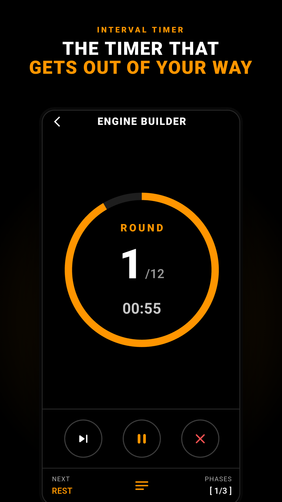
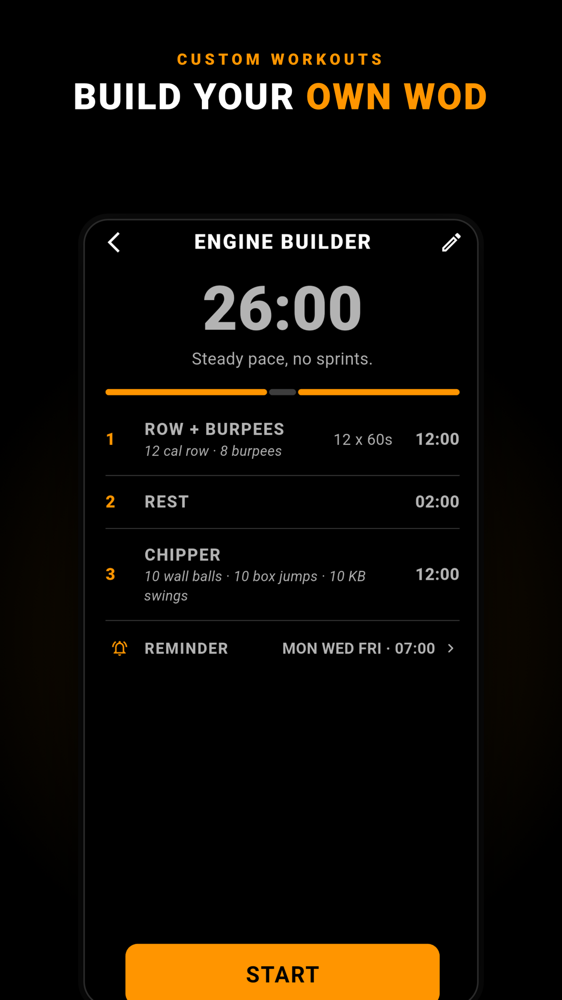
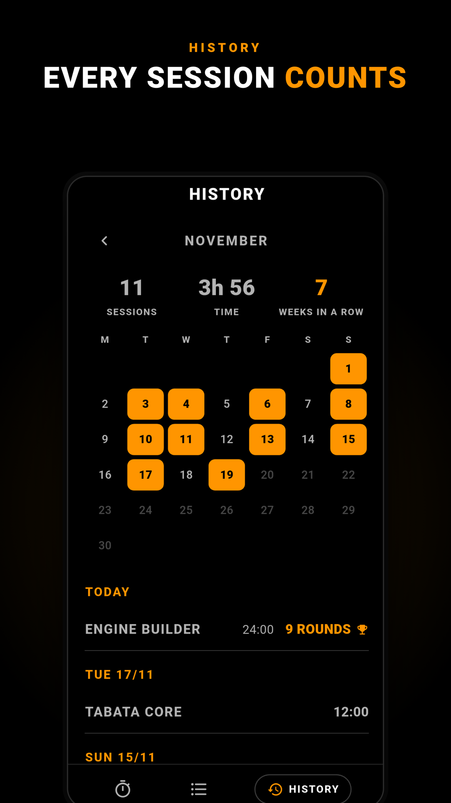
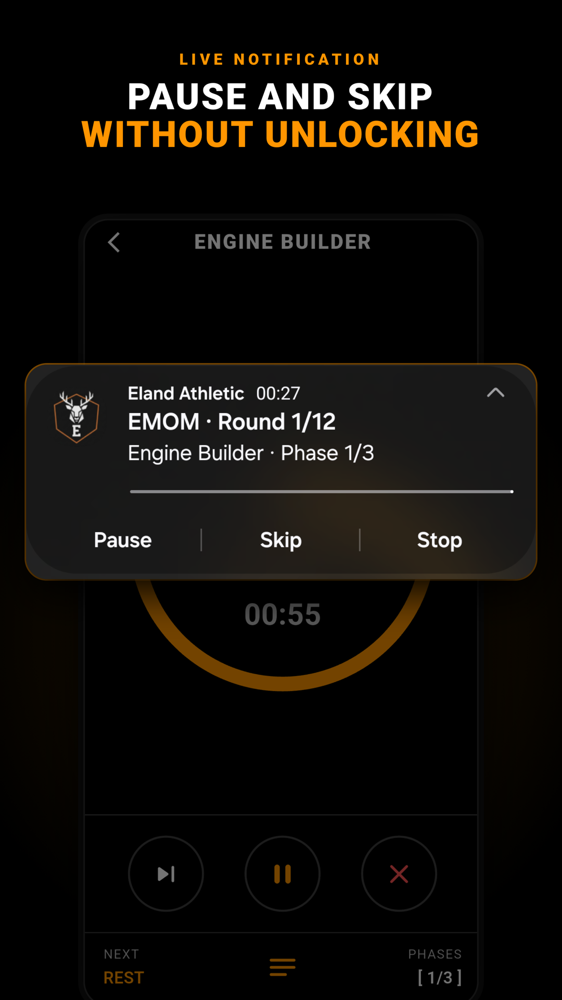
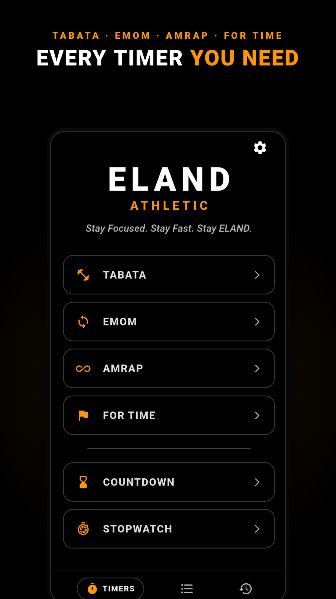
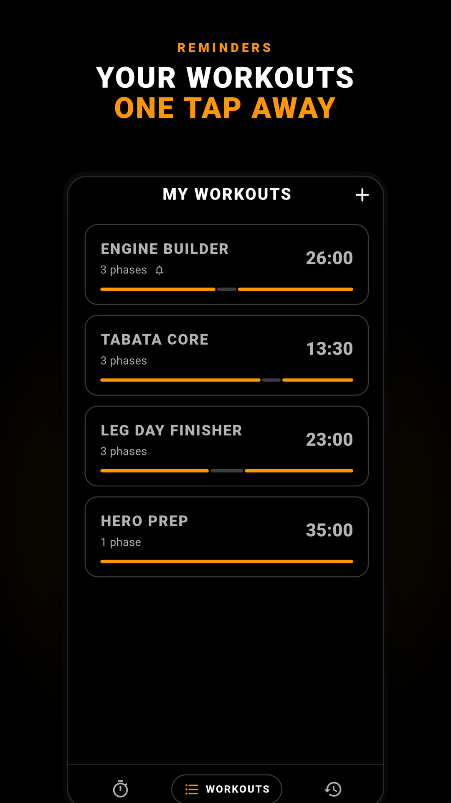
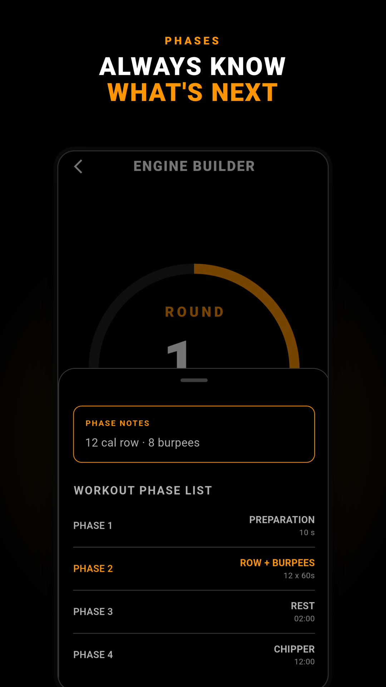
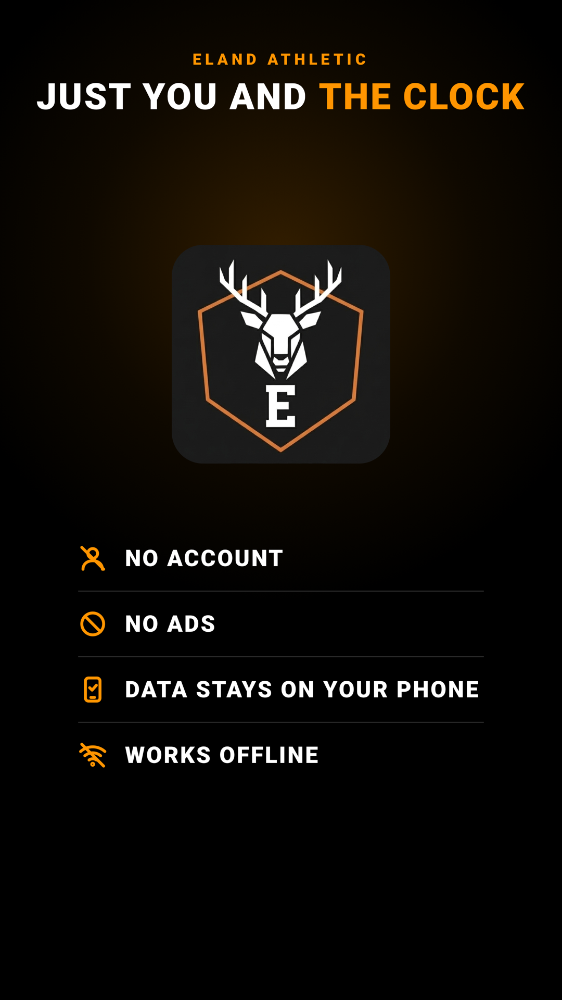

<p align="center">
  
</p>

<h3 align="center">The HIIT timer that gets out of your way.</h3>

<p align="center">
  Tabata · EMOM · AMRAP · For Time · Countdown · Stopwatch<br>
  Custom workouts · Reminders · History · Live notification<br>
  <b>No account. No ads. Your data stays on your phone.</b>
</p>

<p align="center">
  
  
  
  
</p>

## Why Eland

Big numbers, one tap to start, clear cues when the work changes. Eland Athletic is built for the box, the gym and the track: everything you need to run a session, nothing that pulls you away from it.

- **Every timer you need.** Tabata, EMOM, AMRAP, For Time with time cap, Countdown and Stopwatch.
- **Build your own WOD.** Chain timers into phases, add notes ("12 cal row, 8 burpees"), reorder with a drag.
- **Always know what's next.** One swipe during the workout shows every phase and its notes.
- **Control it without unlocking.** On Android 16 the timer is a Live Update in the status bar and on the lock screen, with Pause, Skip and Stop. It keeps running with the screen off.
- **Every session counts.** A history calendar with sessions, total time, weekly streak and personal bests.
- **Never skip a day.** Reminders per workout, on the days and time you choose.
- **Feel the change.** Sound and vibration cues for countdowns, work/rest switches and the finish.
- **Your data, your phone.** No sign-up, no tracking, works offline. Export and import everything as a backup file.
- **Made to stay out of the way.** Black and orange, large type, light or dark theme with six accent colours. English and Italian.

<p align="center">
  
  
  
  
</p>

## What's new in this version

- Custom workouts made of phases with notes
- Reminders for each workout
- History with calendar, weekly streak and personal bests
- Android 16 Live Update with Pause, Skip and Stop
- Bottom tabs: Timers, Workouts, History
- Backup and restore of workouts and history
- Smoother timers and a cleaner look everywhere

## Roadmap

- Professional platform for coaches and boxes
- Nutrition

## Development

Flutter app for Android. The user app is the `userApp` flavor:

```bash
flutter run --flavor userApp -t lib/main_user.dart
flutter test
```

Play Store listing, screenshots and the renderer that makes them live in [`store/`](store/README.md).

## Release

The Play upload key is never stored: `signing/release.sh` derives it from a password (PBKDF2-HMAC-SHA256, 2²¹ rounds, then a deterministic RSA-3072 key), checks its fingerprint against `signing/upload-cert.sha256` and builds the signed bundle and APK. Google Play App Signing holds the app key.

```bash
signing/release.sh   # → build/app/outputs/bundle/userAppRelease/app-userApp-release.aab
signing/export-cert.sh   # → signing/upload-cert.pem, for an upload key reset in Play Console
```

## License

This project is open source for educational and personal use.

Commercial use, redistribution for profit, or inclusion in commercial products is not permitted without prior written permission.
